# Web Page

The radio serves its own web page, so you can control it from a phone or a laptop on the same network. Open `http://tef668x.local:8080`, or the radio's address with port 8080. If the name does not open, see [First Start and Wi-Fi](First-Start-and-Wi-Fi.md#if-tef668xlocal-does-not-open).

No internet is needed. The whole page is one file inside the radio, about 56 KB gzipped. The browser keeps a copy of it. Each time you open the page, the browser asks the radio if the page has changed. It downloads the page again only after a new firmware brings a new one.

In the pictures on this page the network name and the address are placeholders.

## The screens

| Screen | Address | What it is for |
|---|---|---|
| Home | `#` | What the radio is playing, the tuning buttons, the presets and the last stations heard |
| Radio | `#radio` | The band scale, the band, tuning mode, squelch, step and filter, the FM sound switches, RDS and the signal |
| Presets & Log | `#presets`, `#log` | Two tabs: the 99 presets, and the station log |
| DX | `#dx` | DX mode: the station with its meter and readings, and three tabs, Scope, Scanner and Catches |
| Band scope | `#scope` | The level of every channel of the band, with a waterfall of the sweeps |
| Settings | `#settings` | The settings of the radio's menu, in its groups |
| Network | `#network` | Wi-Fi, the hotspot, the PC Link, the access PIN, and turning Wi-Fi or the web server off |
| System | `#system` | The firmware, updates, restart, sleep and the radio's health figures |
| Set up Wi-Fi | `#setup` | Giving the radio a Wi-Fi network, while it is on its own hotspot |

The address is the part after `#`, so `http://tef668x.local:8080/#scope` opens the band scope.

## The frame

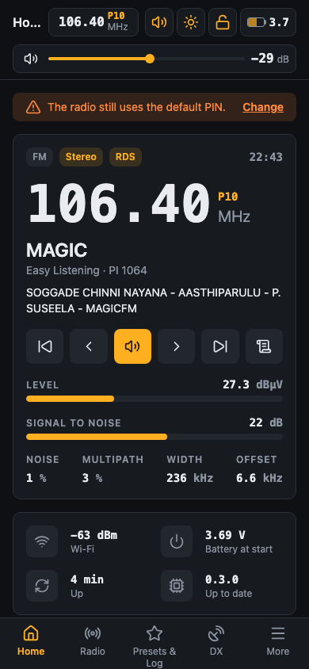

**The menu.** On a phone, four tabs sit at the foot of the screen: **Home**, **Radio**, **Presets & Log** and **DX**. A fifth tab, **More**, opens a list with **Band scope**, **Settings**, **Network** and **System**. From tablet width, every screen is in one menu across the top, and from laptop width each name has its icon.

**The header**, from left to right:

- **The name.** On a phone it is the name of the screen. From tablet width it is **TEF668X**, because the menu shows the screen.
- **The volume.** From tablet width it is a box with the mute key, a slim slider from -60 to 0 dB, and the volume in dB. On a phone the speaker button opens the same box in a strip under the header, and closes it again.
- **The frequency**, in a box, with the preset number, such as `P09`, over the unit. Tap it to open the Radio screen. On a narrow phone the screen's name is cut short to leave room for it, and below 380 pixels the box shows the frequency alone, without the preset number and the unit.
- **The link word.** It shows only when the link to the radio is not well. An orange dot is **Slow**: the last answer took more than 3 seconds. A red dot is **No answer**. The word shows next to the dot from tablet width. With no answer, a red bar also says "The radio is not answering. Trying again.", and the screen is dimmed.
- **The sun or the moon** switches between the light and the dark look. Until you press it, the page follows your device's own setting. After you press it, this browser keeps your choice.
- **The lock** opens the PIN dialog. It shows open when this browser is signed in.
- **The battery**, last, in a box: a small battery on its side, filled to its level, and the level beside it, in per cent or in volts as the radio's own **Battery** setting says, in the menu's Display group. With that setting Off, or on a radio with no battery, there is none. It is orange at 20 % or less and red at 10 % or less. The per cent is a straight line from 3.0 V, empty, to 4.2 V, full. While Wi-Fi runs the radio cannot read the battery, so it shows the reading taken at start, or, with [Battery Check](Display-and-Themes.md#battery-check) on, the newest reading it stopped Wi-Fi for. Point at it to see how old the reading is.

**The foot** of each screen shows the firmware version, such as `TEF668X 0.2.0`, and a **Source on GitHub** link. The link opens only with an internet connection.

Until the radio's first state comes, each screen says "Waiting for the radio…".

### The pictures behind the cards

On a laptop, the top card of each screen has a faint picture behind it, in the accent colour, most of them moving slowly. A phone shows none, since its cards are too narrow for a picture behind their text.

| Screen | The picture |
|---|---|
| Home | The band as the band scope last swept it, with the dial marked and the station there drawn from its level now. With no sweep of this band yet, one peak as tall as the signal, on a floor as high as the noise. It pans slowly across the card |
| Radio | An old radio's glass dial, with a scale each for FM, AM and SW and the shortwave broadcast bands marked. The needle stands at the frequency the radio is on, on its band's scale. On LW, which has no scale, there is no needle |
| Presets & Log | A night sky. A few stars light up and go out, each time somewhere new |
| DX | A radar with its beam turning. Up to three far stations light up and go out |
| Band scope | An analyser screen with its grid. The stations on it rise and fall slowly |
| Settings | Three gears that turn together |
| Network | Bytes in hex, falling in columns |
| System | The ESP32 module and the TEF6686 tuner on a circuit board, with data running along the traces |

Each picture fades out over the left part of its card, where the card's main text is, so no line crosses the frequency or a name.

On a device set to reduce motion, the pictures stand still.

A change of screen or tab fades from the old view to the new one. The frequency and the station name glide to their new place. The same happens when the station changes, for example from the radio's own knob. On a device set to reduce motion, or in a browser without view transitions, the change is made at once.

The browser tab's title names the station on the dial, such as `104.30 MHz RADIO 1`, or its PI before the name comes, so a tab left among others says where the radio is.

## Keys on a laptop

On the Home and Radio screens a laptop has keys. The line "Keys: ← and → step, Shift with them seeks, ↑ and ↓ the volume, M mutes, a preset's number recalls it." under the screen says so.

| Key | What it does |
|---|---|
| ← and → | Step down and up. Hold one to step on: the steps go to the radio as one when you let go, so the dial does not go on moving after |
| Shift with ← or → | Seek down or up. A held key seeks once |
| ↑ and ↓ | The volume, 1 dB a press. It shows at once and goes to the radio once you stop |
| M | Mute, or sound on |
| A number | Recalls that preset. The page waits 1 second after the last digit, so `1` then `2` is preset 12. The number shows large while you type. **Enter** recalls at once, and **Escape** drops it. A number with no preset says "There is no preset 12." |

The keys do nothing while you type in a box, while a dialog is open, or with Ctrl, Alt or Cmd held.

DX has keys of its own, as XDR-GTK does: see [DX](#dx).

The band scale on the Radio screen, and the sweep charts on DX and Band scope, also take keys once they have focus. See [Radio](#radio) and [DX](#dx).

## Signing in

Reading needs no PIN. Only the Settings and Network screens need it to show their values, because they read the stored settings. Without it they say "The settings need the PIN." or "The network settings need the PIN.", with an **Enter the PIN** button. Any change needs the PIN.

When you make a change without signing in, the page opens the PIN dialog: "Changes need the radio's six digit PIN." Type the six digits and press **Sign in**. **Not now** closes it. You can also open it with the lock in the header. When this browser is signed in, the lock opens a dialog that says "This browser can change the radio."

- The PIN starts as `000000`. Until you change it, Home shows "The radio still uses the default PIN." with a **Change** link to Network, and Network says so too. The page never shows the PIN itself.
- A sign in lasts 30 minutes. Using the page does not make it longer.
- Only one browser can be signed in at a time. Signing in on another one signs the first out.
- After five wrong PINs, signing in is locked for 60 seconds, for every browser. The dialog says how many seconds to wait, such as "Too many tries. Wait 60 seconds."
- A restart of the radio, a change of the PIN, or turning the web server off signs you out. There is no sign out button.

## Live

- The radio sends its state to the page over a WebSocket, `GET /api/live`, twice a second. So the screen follows the radio: a turn of the knob or a key press on the radio shows on the page within half a second.
- At most two pages can have the live state at the same time. A third page reads the state every 5 seconds instead. It tries for the live state again, waiting longer each time, up to 60 seconds.
- A browser tab that is hidden asks the radio nothing, and holds no connection.
- If the live state goes quiet for 10 seconds, the page takes it that the radio has gone, and reads the state every 5 seconds until it is back.
- Most changes you make show on the screen at once, before the radio answers.
- If the radio refuses a change, a red note gives the radio's reason, and the page puts back what the radio has. A refusal for want of the PIN opens the PIN dialog instead.
- Some changes, such as saving a preset, show a short note when they work. Each note goes after 4 seconds.
- The presets, the log, the DX catches, the sweeps and the stored settings are read once and kept. They are read again only when the radio says they changed. So a screen opened again shows them at once.
- If one of these reads fails, the card says so, such as "The presets could not be read. Trying again.". The page tries again with the first state that comes at least 5 seconds later. A read refused for want of the PIN is tried again once you sign in.
- There is no save button. The radio stores the station and its settings by itself 10 seconds after the last change.
- If the page cannot draw what the radio sent, for example after the radio took a firmware this page does not know, it says "This page could not draw what the radio sent." with a **Reload** button.

## Dialogs

Every dialog has the same look. The title is at the top and the buttons are in a row at the foot. On a phone, a dialog with a button on the left, such as **Delete** or **Replace**, has its buttons in halves, two to a row, and a last one on its own takes the whole row.

- A button that deletes, such as **Delete**, is on the left.
- On the right is a quiet button that closes it, such as **Cancel**, **Not now** or **Keep it on**, then the main button last.
- In a dialog with a delete button, **Cancel** has the focus when it opens, so a key pressed at once deletes nothing.
- The buttons stay in view when the dialog scrolls, as on a phone held sideways.
- A dialog that holds a form with its own button, such as Wi-Fi network, has a close key by the title instead.
- **Escape**, or a tap outside the dialog, closes it.

## Home

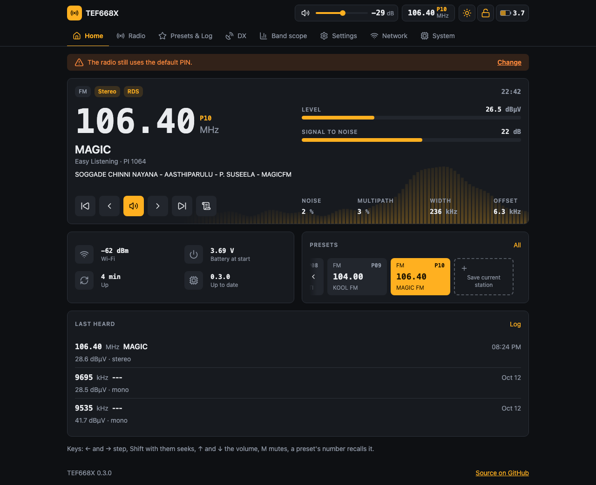

**The big card**, with the band behind it:

- **The chips**: the band, on SW with the metre band the dial is in, such as `SW 22 m`, then **Stereo**, **RDS**, **TP**, **TA**, **Muted**, and **Squelch open** or **Squelch shut** while the squelch is on. With Manual squelch the chip also gives the level it opens at, in dBµV. **DX** shows while DX mode is on, and **Scanning** while a scan runs; each opens its screen. The radio's clock is at the right.
- **The frequency**, large, with the preset number over the unit. Tap it to type another frequency: MHz with a point, such as `98.3`, or kHz without, such as `738`. **Enter** tunes there. **Escape**, or a tap away, leaves it.
- **The station name**. With none, the preset's name, else `---`. Under it the programme type and the PI. With neither, the date once the radio's clock is set. Then two lines of radio text.
- **The buttons**: seek down, step down, mute or sound on, step up, seek up, and **Log this station**.
- **The bars**: **Level** and **Signal to noise**. The volume is in the header, on every screen.
- **The readings** at the foot: Noise on FM, Multipath on FM or Co-channel on AM, Width and Offset.

**The facts card**: the Wi-Fi signal (or Hotspot), the battery at start, how long the radio has been on, and the firmware version, with "Up to date" or the newer version that is ready.

**Presets**: a strip of the preset keys. Each key has the band, the preset number, the frequency and the name. The preset on the dial is lit, second in the strip. Swipe the strip, or use the arrows at its ends. Tap a key to recall it. **Save this**, at the end of the strip, saves the station on the dial as a new preset (see [Presets](#presets)). **All** opens the Presets tab.

**Last heard**: the three newest entries of the station log, with the level, stereo or mono, and the time. Tap one to tune there. **Log** opens the Log tab.

## Radio

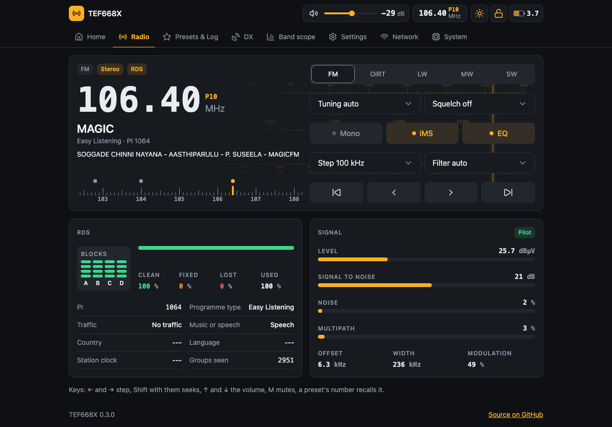

**The reading**, on the left, has an old dial behind it. It shows the same chips, frequency, station name and radio text as Home. Tap the frequency to type another, as on Home.

**The band scale**, at the foot of the reading, is drawn like the radio's own scale. It has a mark every 100 kHz on FM and every 10 kHz on AM, numbered every tenth mark.

- Swipe it to look along the band. Each tune brings the dial back to the middle.
- Tap it to tune there, to the nearest channel of the step in use.
- A dot over the marks shows each preset of this band. The one on the dial is lit. Point at a dot to see its name, and tap it to recall it.
- Give it the focus with the Tab key, and ← and → step the dial.

**The controls**, on the right, one row each:

- **Band**: FM, OIRT, LW, MW, SW.
- Two drop-downs. The tuning mode: **Tuning manual**, **Tuning auto**, **Tuning presets** or **Tuning meter band**. The squelch: **Squelch off**, **Squelch auto** or **Squelch manual**.
- **Mono**, **iMS** and **EQ**, on FM only. Each is a key with a lamp, lit when on. They are the same switches as **Force mono**, **iMS** and **Equalizer** in the FM reception group of [Settings](#settings).
- Two more drop-downs: the step, such as **Step 100 kHz**, and the filter, such as **Filter 114 kHz**, from what this band offers. **Filter auto** lets the tuner choose the width.
- Four buttons: seek down, step down, step up, seek up.

The volume is in the header. See [The frame](#the-frame).

**RDS**:

- **Blocks**: blocks A to D of the last group, as the radio's DX page draws them. Four lit for a clean block, three or two for an error the tuner fixed, one for an error it could not fix, none with no RDS.
- A bar and four figures for how well RDS comes in: **Clean**, **Fixed** and **Lost**, of the blocks the tuner handed over, and **Used**, the share of groups something was decoded from. Before the first group the bar says "No RDS yet".
- **PI**, **Programme type**, **Traffic**, **Music or speech**, **Country**, **Language**, **Station clock** (the station's own time) and **Groups seen**. A fact the station has not sent shows `---`.
- **Alternative frequencies**, when the station sends them. Tap one to tune there.

**Signal**: bars for **Level**, **Signal to noise**, **Noise** on FM, and **Multipath** on FM or **Co-channel** on AM. Then the **Offset**, the **Width** and the **Modulation**. A **Pilot** chip shows when the stereo pilot is there.

## Presets & Log

The two tabs share the top card. It shows the station on the dial, with the band, a **Not a preset** chip when it is not one, the frequency and the name. On the right are the tab's tools, and under them the **Presets** and **Log** tabs. `#presets` and `#log` open each tab.

### Presets

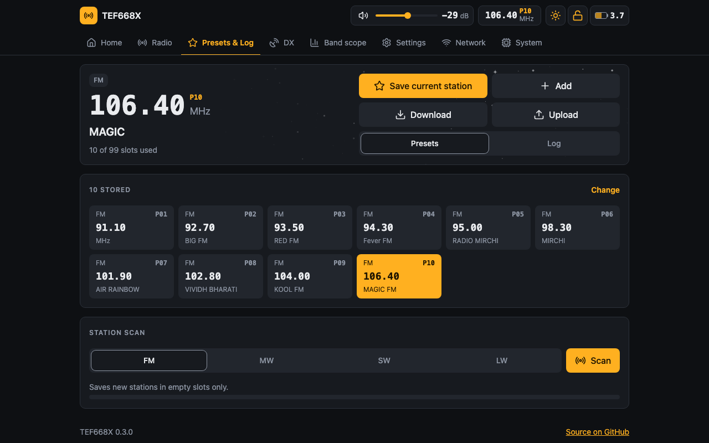

The line under the station says how many of the 99 slots are used. The presets show as keys, like the preset buttons on a radio. Each key has the band, the preset number, the frequency and the name. The preset on the dial is lit. Tap a key to recall it.

- **Save current station**, **Save current** on a phone, saves the station on the dial as a new preset, with its RDS name. The radio picks the slot: the lowest free one, from its own list. So a preset stored on the radio after the page opened is never written over. A station that is a preset already is refused, and the note says which preset it is.
- **Add** opens a dialog for a new preset, in the first free slot.
- **Download** gives the presets as a CSV file, `presets.csv`.
- **Upload** reads a CSV file of up to 16 KB and asks how to use it. **Merge** adds its presets into empty slots and keeps the rest. **Replace** makes the list exactly the file.
- **The band filter**: with presets on more than one band, **All** and each band with presets. The card title says how many are shown.
- **Change** puts the keys in Change mode. It shows every slot up to one past the last used, the empty ones dashed. Tap a key to change it, or tap an empty slot to add one there. Drag a key onto another slot to move it: onto another preset the two swap, onto an empty slot it goes there. Dragging works with a finger too. **Done** leaves Change mode.

**Station scan**, the card under the keys, walks a band and saves each new station it finds, one that is not a preset yet, as the radio's own station scan does. Pick **FM**, **MW**, **SW** or **LW**, and press **Scan**. It saves into empty slots only, so no preset is changed. While it runs, the card shows **Scanning** and the channels done, such as `120 of 211 channels`, with a bar. After it, it shows **Complete** or **Stopped** and the result, such as `Found 13, saved 1.`, with `Full, 2 not saved.` when the slots ran out. A scan started on the radio shows here too. Any tune, seek or change of band stops it, from the radio or from this page, such as a tap on a preset key. FM takes about 30 seconds, SW about 4 minutes.

**The preset dialog** is "Add a preset", or "Preset 9" for a stored one.

- **Slot** and **Frequency**: MHz with a point, such as `98.3`, or kHz without, such as `738`. The line under them says the band the frequency is on.
- When the slot holds another preset, the dialog warns: saving replaces it, or, for a stored preset moved to that slot, swaps the two.
- It refuses a frequency another preset already has.
- **Name**, up to 16 letters.
- **Bandwidth**: **The radio chooses**, or a width of the band.
- For a stored preset, what the radio knows of the station, each when it has it: **PI**, **Programme type**, **Country** and **Saved**, the time it was saved.
- **Save** stores it. **Delete** deletes a stored preset.

The CSV format is in [Presets and Station Scan](Presets-and-Station-Scan.md#presets-as-a-csv-file).

### Station log

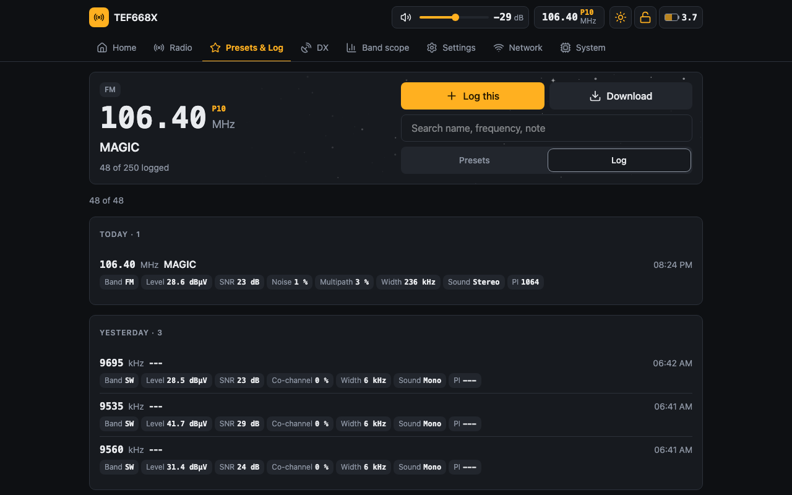

The [station log](Station-Log.md), newest first, in one card for each day: Today, Yesterday, then the date. Entries logged before the clock was set are under "Clock not set". The line under the station says how many entries the log holds, of 250.

- **Log this** writes the station on the dial to the log.
- **Download** gives the log as a CSV file, `logbook.csv`.
- **The search box** finds entries by frequency, band, name, PI, note or radio text. A line over the cards says how many entries match.
- Each entry shows the frequency, the name or the PI, and the time. "renamed" marks a name you typed. A chip shows each reading: Band, Level, SNR, Noise on FM, Multipath on FM or Co-channel on AM, Width, Sound (Stereo or Mono) and PI. The note shows under them.
- **Tap an entry** to open it. It shows when it was logged, the radio text, every reading, and the programme type and the country when the radio kept them. You can change the **Name**, up to 8 letters, and write a **Note**, up to 32 letters, then press **Save**. **Tune** tunes the radio to it. **Delete** deletes it.

## DX

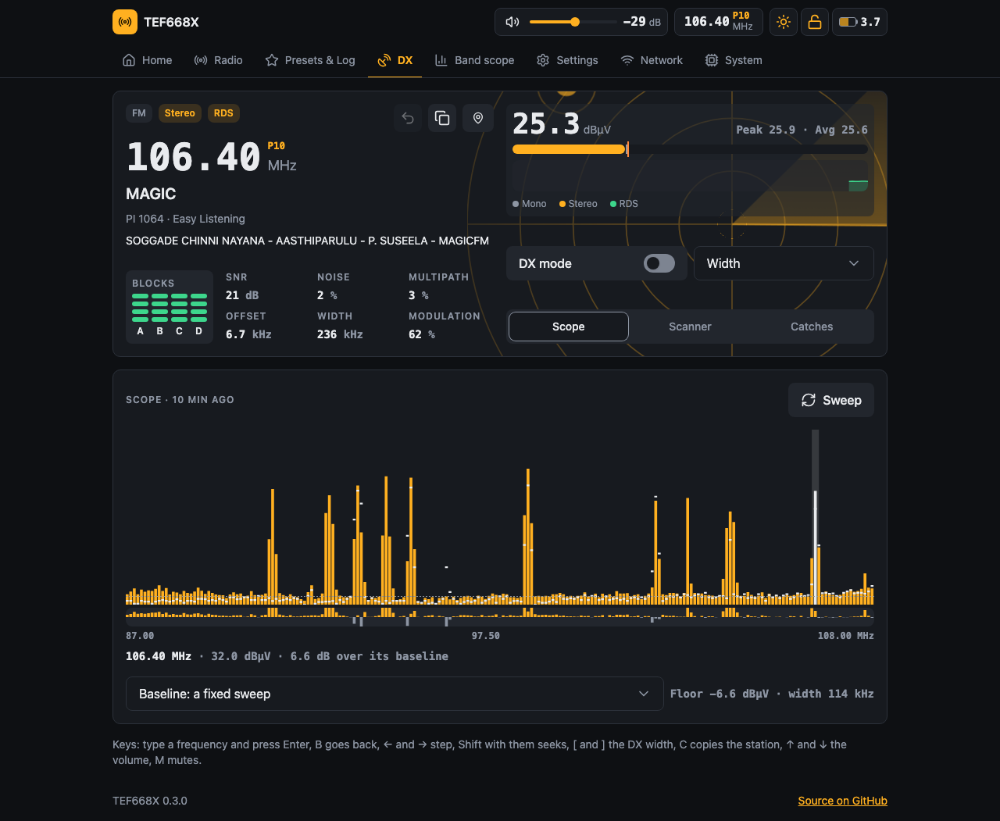

The radio's [DX mode](DX-Mode.md), made to be worked from a laptop the way XDR-GTK is. The picture shows the Scope tab.

**The top card** holds the station and its signal. On the left:

- The chips: the band, Stereo, RDS, TP, TA and the others the [Radio](#radio) screen shows. At their right, three buttons: **Back** goes to the frequency before, **Copy** puts the station on the clipboard, and **Find on map** opens the station on the fmdx.org map in a new tab.
- The station on the dial. Its name builds up one letter at a time, the letters not yet heard as dashes. Under it are the PI, the ECC, the country and the programme type. The PI has a `?` for each digit not yet sure, and is `0000` for a station that sends no ID.
- Two lines of radio text.
- The RDS blocks A to D of the last group, as on [Radio](#radio), beside the SNR, Noise, Multipath, Offset, Width and Modulation.
- The alternative frequencies the station sends. Tap one to tune there.

On the right:

- **The meter**: the level now, large, with the highest (**Peak**) and the average (**Avg**) since the last tune. A bar shows the level, with the peak as an orange mark and the average as a thin one. Under it, the level of the last minute as a filled line, grey for mono, orange for stereo and green while RDS comes in. Over the line, the mouse wheel steps a channel up or down. The meter starts again on each tune.
- **DX mode**, on or off, and the **Width**, the filter width DX mode uses. Picking a width while DX mode is off turns it on first, as **Start scan** and **Sweep** do. DX mode works on FM and OIRT only. On another band the card says "DX mode works on FM and OIRT. Switch to FM first."
- The three tabs, **Scope**, **Scanner** and **Catches**.

**The level unit.** Tap the level to show it in dBµV, the radio's own unit, in dBf or in dBm, as XDR-GTK and FM-DX Webserver give them: dBf is dBµV + 11.25, and dBm is dBf - 120. This browser keeps the choice, and every level the page shows follows it. Settings and the CSV files stay in dBµV, as the radio keeps them.

**Back** goes to the frequency the dial last rested on for 3 seconds or more before it moved, whether the page, the knob or a PC moved it, and pressed again comes back. A seek, a scan or a turn of the knob past a station does not count as a rest. **Copy** gives one line, such as `104.30 MHz PI 9201 PS RADIO 1 54.2 dBµV`. **Find on map** shows once the PI is sure; the map lists every station on the frequency and finds the PI among them. It needs the internet on the phone or laptop, not on the radio.

**Keys on DX**, on a laptop, not while you type in a box or with a dialog open:

| Key | What it does |
|---|---|
| A number or a point | Starts a frequency, shown large while you type. **Enter** tunes there, **Backspace** takes the last one back and **Escape** drops it. On FM, 875 is 87.5 MHz and 1043 is 104.3 MHz, as FM-DX Webserver reads them |
| B | Back, as the button |
| [ and ] | The DX width, narrower and wider, while DX mode is on |
| C | Copy, as the button |
| ← and → | Step down and up; with Shift, seek |
| ↑ and ↓ | The volume |
| M | Mute, or sound on |

**Scope**: a chart of DX mode's last level sweep.

- It shows a bar for each channel, the baseline, the highest levels, the floor as a dashed line, and the dial. While the radio shows its own scope, its cursor is a green line.
- A strip under the chart shows the rise of each channel over its baseline.
- A line under the chart gives the channel pointed at: its frequency, its level, and how far it is over or under its baseline, such as `20.0 dB over its baseline`. Point at a channel to read it, and tap it to tune there. With the focus on the chart, ← and → pick a channel and **Enter** tunes there.
- **Sweep** sweeps the band again, which takes about 4 seconds. The chart is dim until the new sweep comes.
- **Baseline** picks what the sweep is compared with: the median of the kept sweeps, or one kept sweep by its time.

**Scanner**: what the scanner is doing (Ready, Scanning, or Stopped on a frequency), how it is set to scan, a progress bar, the channels done, and how many stations it found. **Start scan** starts it, **Stop** stops it, and **Go on** carries on after a stop. **Learn locals** runs the radio's [Learn Local Stations](DX-Mode.md#learn-local-stations).

**Catches**: the stations caught in DX mode, newest first. Each shows a **New** chip for a new one, the PI, the country, the level, how many times it was heard and when. Tap one to tune there. The map pin opens it on the fmdx.org map. **Log** writes it to the station log, and **Logged** marks one already written. **FMLIST CSV** gives the file for FMLIST.

While DX mode watches the presets, a preset that comes up shows as a note, such as "98.30 MHz up 12 dB".

## Band scope

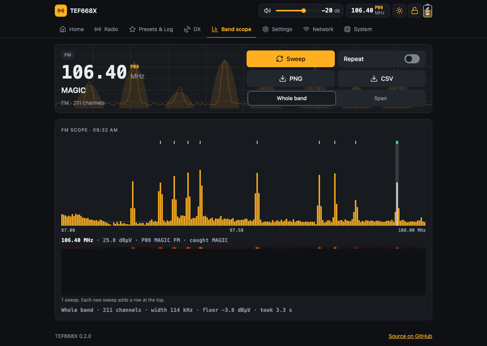

The [band scope](Band-Scope.md) in the browser, on every band.

**The top card** has an analyser screen behind it on a laptop, and the station on the dial. On SW its band chip names the metre band the dial is in, such as `SW 22 m`, as every screen's chips do. The line under the station gives the band and the channels of the sweep. The tools:

- **Sweep** sweeps once.
- **Repeat** asks for the next sweep each time one ends, to watch the band change. Each sweep mutes the radio for its seconds. So Repeat is off when the page opens, and it stops when you switch to another browser tab or a sweep is stopped on the radio.
- **Log** logs the station on the dial to the [Station log](#station-log), as Home does.
- **PNG** saves the chart, the waterfall and a line about the sweep as a picture. **CSV** saves the sweep in the chart: each frequency in kHz and its level in dBµV.
- **Whole band** or **Span**: the span is the part round the dial, 3.6 MHz on FM or 360 kHz on AM. The whole of SW is too wide for one sweep, so on SW the choice is the metre band the dial is in, such as **22 m band**, which is the first choice there; between two metre bands SW has the span only.

**The chart card**:

- **The chart**: a bar for every channel. Your presets of this band are small ticks along the top. On FM and OIRT the DX catches are green marks. The dial is marked, and so is the radio's own cursor. Point at a channel to read its level and its preset or catch. Tap it to tune there. With the focus on the chart, ← and → pick a channel and **Enter** tunes there.
- **The waterfall** under it: every sweep this page has seen of the same channels, up to 24, newest at the top, brighter where stronger. Tap a row, or use **Older** and **Newer**, to see that sweep in the chart. The page keeps them only while it is open.
- The line at the bottom gives the channels, the width, the floor and how long the sweep took.

It also shows sweeps started elsewhere: on the radio, from a PC's [spectral scan](PC-Tools.md#spectral-scan), or over the [HTTP API](HTTP-API.md#band-scope).

## Settings

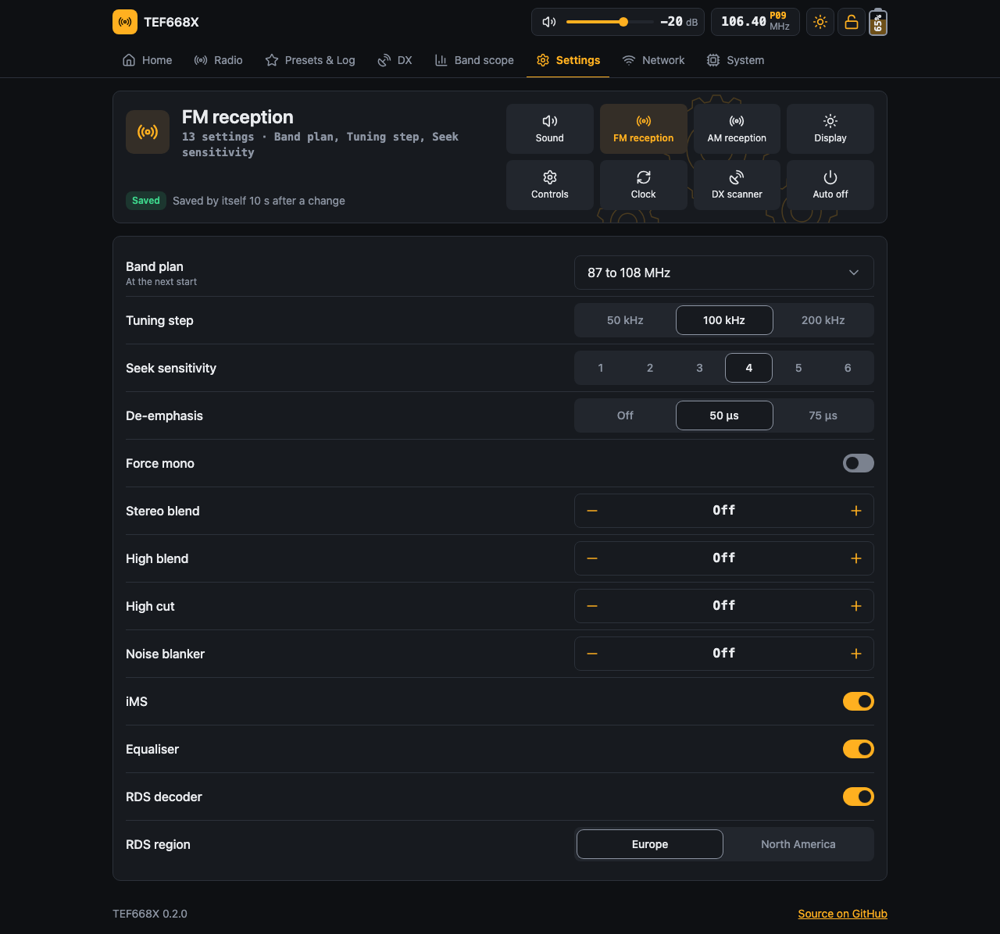

The settings of the radio's menu, in the same groups: **Sound**, **FM reception**, **AM reception**, **Display**, **Controls**, **Clock**, **DX scanner** and **Auto off**. What each setting does is in the [Menu Guide](Menu-Guide.md).

**The top card** has gears behind it. It shows the open group, how many settings it has, and a chip for the radio's own save: **Saved**, **Saving in** a few seconds, **Saving by itself is off**, or **The last save failed**. Each group is a tile: beside the group on a laptop, under it on a phone. Tap a tile to open that group. Its settings are in the card under it, one row each.

- A change goes to the radio at once.
- A setting is a switch, a box that reads **On** or **Off** and is tinted while on, a row of choices, a drop-down, or a value with **-** and **+**. Hold **-** or **+** to step on. The value is sent once, a moment after you let go.
- **At the next start** marks a setting the radio takes only after a restart, such as the band plan or the MW channel spacing. A note says so when you change one.
- **Taken only on FM** marks an FM setting while the radio is on another band.
- **Display** also has the Custom theme's colours, eight colour pickers. See [Display and Themes](Display-and-Themes.md).
- **Controls** also has **Measure the knob**, which teaches the radio the two ends of the volume knob. Turn the knob all the way down and all the way up, then press **Done**, or **Cancel**. The lowest and highest readings show while you turn it.
- A change made on the radio's own menu shows here too, once the radio has stored it.

## Network

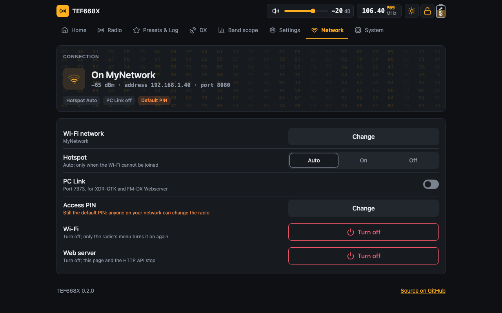

**Connection**, with falling bytes behind it: the network the radio is on, or its own hotspot. Then the Wi-Fi signal as bars and in dBm, the address and the port. Chips show the hotspot setting, the PC Link and the number of PCs on it, and **Default PIN** while the PIN is still `000000`.

Then one row each:

- **Wi-Fi network**: the network stored. **Change** opens a dialog with the **Network name** and the **Passphrase**. **Show** shows what you typed. Turn on **No passphrase** for an open network. **Save and join** moves the radio to that network at once, so this page may lose it while it does.
- **Hotspot**: Auto, On or Off. Auto brings up the radio's own hotspot only when the Wi-Fi cannot be joined. A choice that takes the radio off the network this page reaches it on asks first. See [Wi-Fi and Hotspot](Wi-Fi-and-Hotspot.md).
- **PC Link**: opens port 7373 for XDR-GTK and FM-DX Webserver. The row lists the address of each PC connected. See [PC Tools](PC-Tools.md).
- **Access PIN**: **Change** opens a dialog. Type the new PIN under **New PIN** and **Again**, then press **Change PIN**. It works at once and signs every browser and every PC out, so the page asks you to sign in with the new PIN.
- **Wi-Fi** and **Web server**: **Turn off**. Each asks first, with **Keep it on** or **Turn off**. Only the radio's own menu, Connectivity, turns them on again.

## System

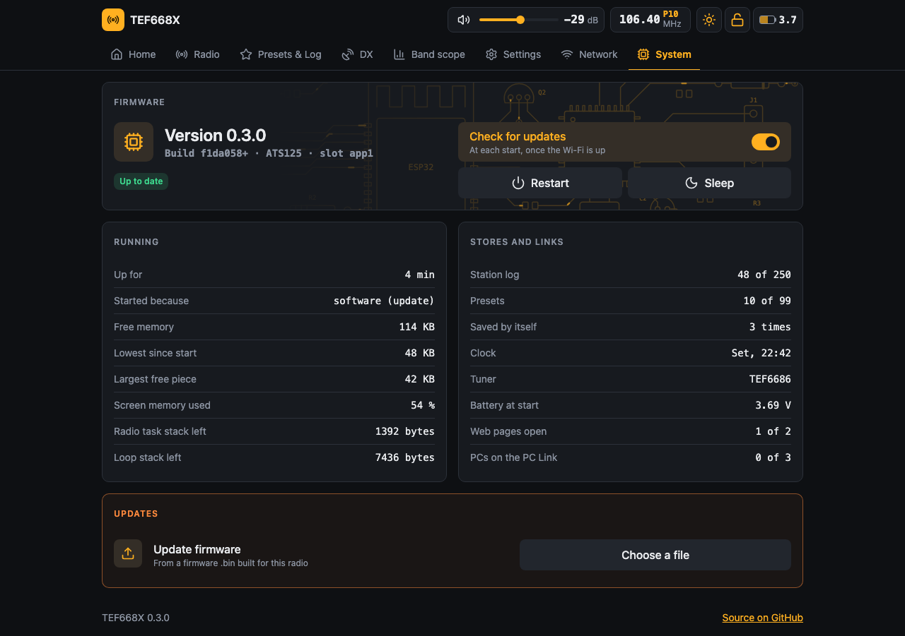

**Firmware**, with a circuit board behind it:

- The version, the build, the board and the slot it runs from.
- A chip says what the update check found, such as "Up to date" or "0.3.0 is out". While a new firmware is on trial, another chip says "On trial until it joins the Wi-Fi".
- **Check for updates** turns the check at each start on or off.
- **Restart**: asks first, then restarts the radio. It is refused while a new firmware is on trial.
- **Sleep**: asks first, then puts the radio to sleep. Press the tuning knob on the radio to wake it. The page cannot wake it. See [Sleep and Auto Off](Sleep-and-Auto-Off.md).

**Running** and **Stores and links**: the radio's health, in two cards.

| Running | Stores and links |
|---|---|
| Up for | Station log, used of 250 |
| Started because | Presets, used of 99 |
| Free memory | Saved by itself, how many times |
| Lowest since start | Clock |
| Largest free piece | Tuner |
| Screen memory used | Battery at start |
| Radio task stack left | Web pages open, of 2 |
| Loop stack left | PCs on the PC Link, of 3 |

**Updates**:

- While a newer release is known, it shows its version and size. **Install** with its version asks first, then downloads it from GitHub, writes it and restarts the radio. If the radio does not join the Wi-Fi after that, it goes back to the version before. See [Updating](Updating.md).
- **Update firmware**: **Choose a file** picks a firmware `.bin` built for this radio, and **Install this file** sends it. The page shows how much has been sent.

After an install or a restart, the page waits for the radio and says when it is back, with its version.

## First start on the hotspot

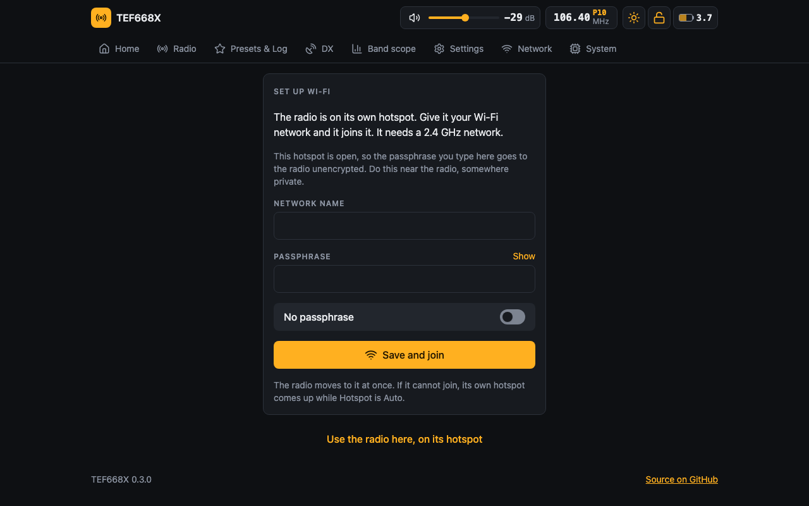

While the radio is on its own hotspot, the page opens on **Set up Wi-Fi**. It needs no PIN there. Type your network's name and passphrase and press **Save and join**. The network must be 2.4 GHz. The hotspot is open, so do this near the radio, somewhere private.

The page then says the radio is joining your network. Join the same network on your phone or laptop, and open `http://tef668x.local:8080` again. If that does not open, the radio's menu has its address: Connectivity, Network Info. If the radio cannot join in 20 seconds, for example with a wrong passphrase, its hotspot comes back and this page with it.

**Use the radio here, on its hotspot** skips the setup and opens the other screens. The page asks again in a new browser tab. You can open the setup at any time at `#setup`.

See [First Start and Wi-Fi](First-Start-and-Wi-Fi.md).

## What the web page does not do

These are on the radio only: the station scans (FM, AM, SW and LW Station Scan), the touch calibration, and the language of the screen, **Display > Language**. The web page is in English whatever language the screen shows.

The radio answers nothing while a level sweep reads the band, about 4 seconds on FM and up to 7.5 seconds on MW. The page waits, and the chart stays dim until the new sweep comes.
